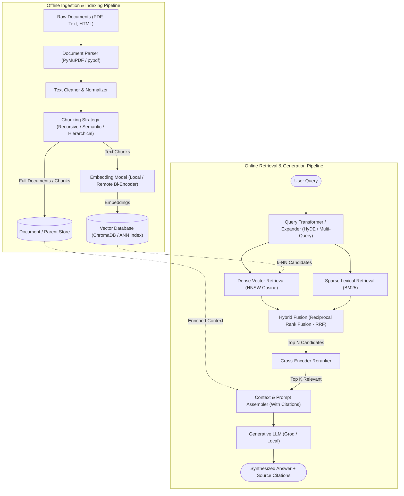

# End-to-End RAG Architecture

This document provides a holistic conceptual architecture of a modern Retrieval-Augmented Generation (RAG) system, outlining the offline indexing lifecycle and the online retrieval/generation loop.

---

## 🏛️ High-Level System Architecture

---

## 🔄 Core Components Breakdown

### 1. Ingestion & Document Processing
- **Parsing:** Raw formats (PDF, Markdown, tables) converted into raw structural text units.
- **Cleaning:** Stripping header/footer noise, hyphenation artifacts, and encoding anomalies.
- **Chunking:** Partitioning text into semantic units balancing context breadth with embedding focus.

### 2. Indexing & Representation
- **Bi-Encoder Embeddings:** Text chunks projected into a continuous vector space $\mathbb{R}^d$.
- **Vector Index:** Approximate Nearest Neighbors (ANN) graph indexes (e.g., HNSW) enabling sub-linear search latency.

### 3. Query Transformation & Hybrid Retrieval
- **Query Rewriting:** Disambiguating conversation context, generating hypothetical answers (HyDE), or decomposing multi-part questions.
- **Hybrid Fusion:** Combining exact lexical keyword matching (BM25) with semantic vector search via Reciprocal Rank Fusion:
  $$RRF\_Score(d) = \sum_{m \in M} \frac{1}{k + r_m(d)}$$

### 4. Precision Reranking
- **Cross-Encoder:** Passing (Query, Document) pairs jointly through full transformer self-attention to calculate deep token-level relevance scores, filtering out false-positive vector matches.

### 5. Grounded Synthesis & Attribution
- **Context Injection:** Feeding the top reranked chunks into the prompt context window.
- **Strict Grounding:** Explicit system instructions requiring answers to cite source documents by ID and acknowledge unknown facts.
