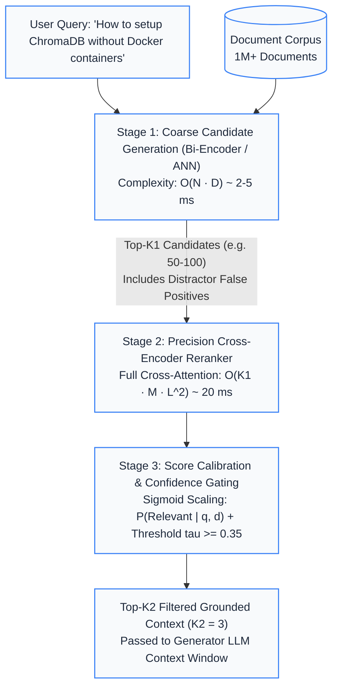

# Track 03 — Retrieval Engineering

Retrieval engineering bridges the semantic gap between raw user queries and knowledge corpora through intelligent pre-retrieval reasoning, multi-representation indexing, precision reranking, and rank aggregation.

## Notebook Curriculum

| Notebook | Title | Status | Description |
|---|---|---|---|
| [**03.1**](file:///Users/bharathm/Documents/Self%20Learning/RAG_from_scratch/tracks/03-retrieval-engineering/01_query_transformation_and_rewriting.ipynb) | **Query Transformation, Expansion, and Rewriting** | **VALIDATED** | Overcomes vocabulary mismatch and stylistic asymmetry via Query Rewriting, Step-Back Prompting, Sub-Query Decomposition, and Hypothetical Document Embeddings (HyDE) with Reciprocal Rank Fusion (RRF). |
| [**03.2**](file:///Users/bharathm/Documents/Self%20Learning/RAG_from_scratch/tracks/03-retrieval-engineering/02_cross_encoder_reranking.ipynb) | **Advanced Reranking & Cross-Encoder Architectures** | **VALIDATED** | Resolves the Bi-Encoder representation bottleneck via full cross-attention transformer scoring ($O(N \cdot D)$ vs $O(N \cdot M \cdot L^2)$), score calibration (sigmoid scaling & min-max), top-$k$ confidence truncation, and cascaded two-stage retrieval. |
| **03.3** | Sparse Lexical Search (BM25), Dense Retrieval, and Hybrid Search | *Planned* | Inverted index mechanics, BM25 scoring parameters ($k_1, b$), dense vs. sparse trade-offs, and reciprocal rank fusion. |
| **03.4** | Advanced Retrieval: Hierarchical Indexing & Multi-Vector Patterns | *Planned* | RAPTOR recursive summarization trees, Parent-Child / Multi-Vector retrieval, and late-interaction models (ColBERT). |

## Architectural Overview: Two-Stage Cascaded Retrieval

## Generated Visual Assets

- [Cross-Attention Token Interaction Heatmap](file:///Users/bharathm/Documents/Self%20Learning/RAG_from_scratch/assets/diagrams/track03_cross_attention_heatmap.png)
- [Retrieval Quality Benchmark Chart](file:///Users/bharathm/Documents/Self%20Learning/RAG_from_scratch/assets/diagrams/track03_reranking_benchmark.png)
- [Vector Space Geometry PCA Projection](file:///Users/bharathm/Documents/Self%20Learning/RAG_from_scratch/assets/diagrams/track03_query_transformation_geometry.png)
