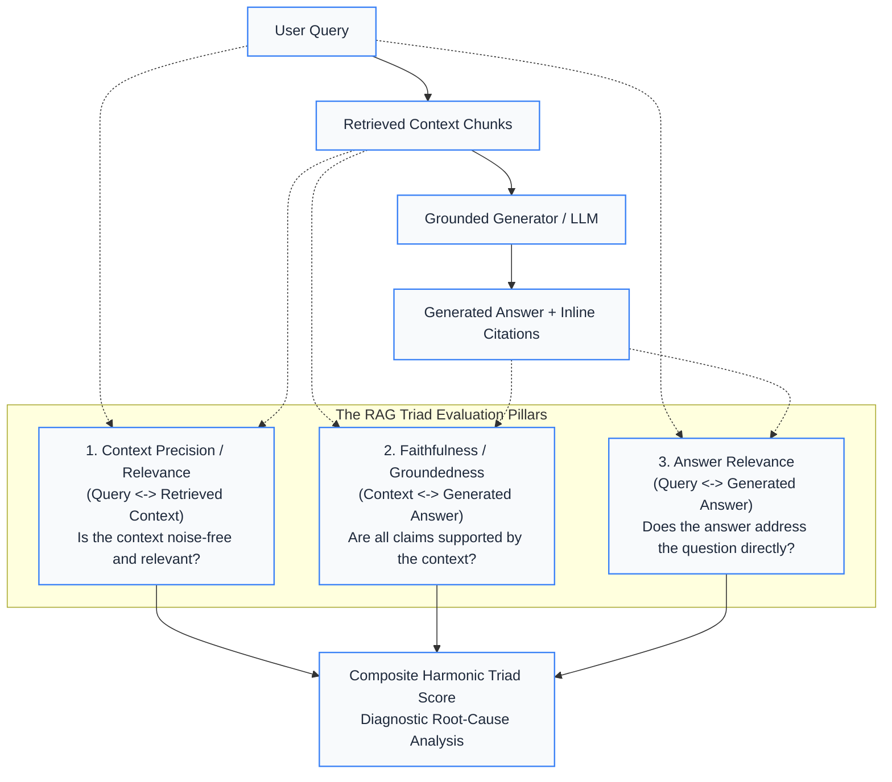

# Track 04 — Generation, Synthesis, and Automated RAG Evaluation (RAGAS / TruLens)

Generation and synthesis represent the second half of the RAG pipeline. This track covers grounded response synthesis, epistemic refusal handling, citation attribution, and automated quantitative evaluation using the RAG Triad (TruLens) and RAGAS evaluation paradigms.

## Notebook Curriculum

| Notebook | Title | Status | Description |
|---|---|---|---|
| [**04.1**](file:///Users/bharathm/Documents/Self%20Learning/RAG_from_scratch/tracks/04-generation-and-evaluation/01_rag_evaluation_framework.ipynb) | **Automated RAG Evaluation Framework (RAGAS & TruLens)** | **VALIDATED** | Complete offline-first implementation of Context Precision (MAP@K), Context Recall, Faithfulness (hallucination detection via atomic proposition decomposition), Answer Relevance, and the Harmonic RAG Triad composite score. Includes grounded synthesis prompts, citation audits, and diagnostic failure mode classification. |

## Architectural Overview: The RAG Triad

## Generated Visual Assets

- [RAG Triad & RAGAS Metric Fingerprints Radar Chart](file:///Users/bharathm/Documents/Self%20Learning/RAG_from_scratch/assets/diagrams/track04_evaluation_radar.png)
- [Context Precision Rank-Order Decay Curve](file:///Users/bharathm/Documents/Self%20Learning/RAG_from_scratch/assets/diagrams/track04_context_precision_decay.png)
