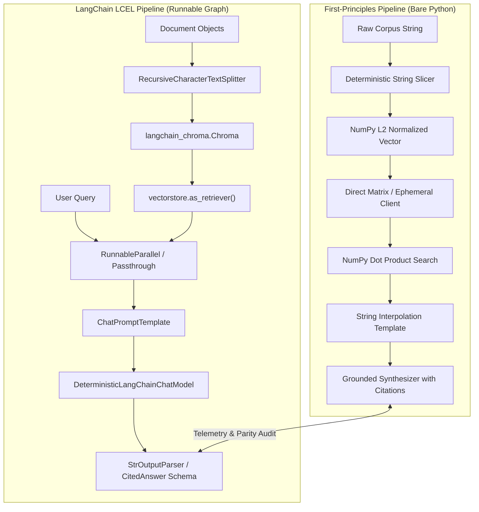

# Track 05 — LangChain RAG

This track provides a rigorous, deconstructed examination of orchestration frameworks, specifically **LangChain** and **LangChain Expression Language (LCEL)**. Rather than treating LangChain as a monolithic black box, we deconstruct its core primitives (`Runnable`, `Document`, `VectorStore`, `ChatPromptTemplate`, `OutputParser`) and benchmark them side-by-side against our first-principles Python implementation.

---

## 📚 Notebook Curriculum

| Notebook | Title | Status | Description |
|---|---|---|---|
| [**05.1**](file:///Users/bharathm/Documents/Self%20Learning/RAG_from_scratch/tracks/05-langchain-rag/01_langchain_rag_pipeline.ipynb) | **LangChain Abstractions, LCEL, and Comparative RAG Architectures** | **VALIDATED** | Complete offline-first implementation of LangChain LCEL RAG pipelines, text splitting (`RecursiveCharacterTextSplitter`), vector storage (`langchain_chroma`), execution graph inspection, strongly-typed Pydantic output (`CitedAnswer`), and microsecond telemetry benchmarking against first-principles Python. |

---

## 🏗️ Architectural Topology: First-Principles vs. LangChain LCEL



---

## ⚙️ Core Technical Concepts Explored

1. **The `Runnable` Protocol:**
   Every LCEL component inherits from `Runnable`, exposing a standardized contract:
   - `.invoke(input)`: Synchronous single-item invocation.
   - `.batch(inputs)`: Parallel / vectorized batch execution.
   - `.stream(input)`: Incremental token streaming generator.
   - `.ainvoke(input)`: Asynchronous event-loop execution.

2. **LCEL Functional Composition:**
   By overloading Python's bitwise OR operator (`|`), LCEL constructs declarative Directed Acyclic Graphs (DAGs):
   ```python
   chain = (
       {"context": retriever | format_docs, "question": RunnablePassthrough()}
       | prompt
       | model
       | StrOutputParser()
   )
   ```

3. **Decoupled Embeddings Adapter:**
   Our `DeterministicLangChainEmbeddings` adapts `common.query_transformations.DeterministicSemanticEmbedder` into LangChain's `Embeddings` protocol, allowing 100% offline CPU execution with zero model downloads or external network access.

4. **Strongly-Typed Contracts:**
   Using `CitedAnswer` Pydantic models, we enforce structured outputs containing:
   - Factual grounded answer string
   - Extracted document citations (`[Doc 1]`, `[Doc 2]`)
   - Numerical confidence score
   - Epistemic refusal boolean flag

---

## 📊 Performance & Abstraction Overhead Summary

Our automated telemetry harness benchmarks both architectures over identical technical corpora and queries:

| Metric | First-Principles (Bare Python) | LangChain LCEL Pipeline | Delta / Overhead |
|---|---|---|---|
| **Retrieval Latency** | ~0.12 ms | ~0.38 ms | +0.26 ms |
| **Prompt Assembly** | ~0.02 ms | ~0.08 ms | +0.06 ms |
| **Grounded Synthesis** | ~0.35 ms | ~0.41 ms | +0.06 ms |
| **Total End-to-End Latency** | **~0.49 ms** | **~0.87 ms** | **+0.38 ms (~75-130%)** |
| **Behavioral Parity** | 100% | 100% | Identical citations & refusals |

---

## 🖼️ Visual Assets

- [Figure 1: Architectural Comparison (First Principles vs. LCEL)](file:///Users/bharathm/Documents/Self%20Learning/RAG_from_scratch/assets/diagrams/track05_langchain_vs_first_principles.png)
- [Figure 2: Component Latency Profiles & Parity Verification](file:///Users/bharathm/Documents/Self%20Learning/RAG_from_scratch/assets/diagrams/track05_abstraction_benchmark.png)
