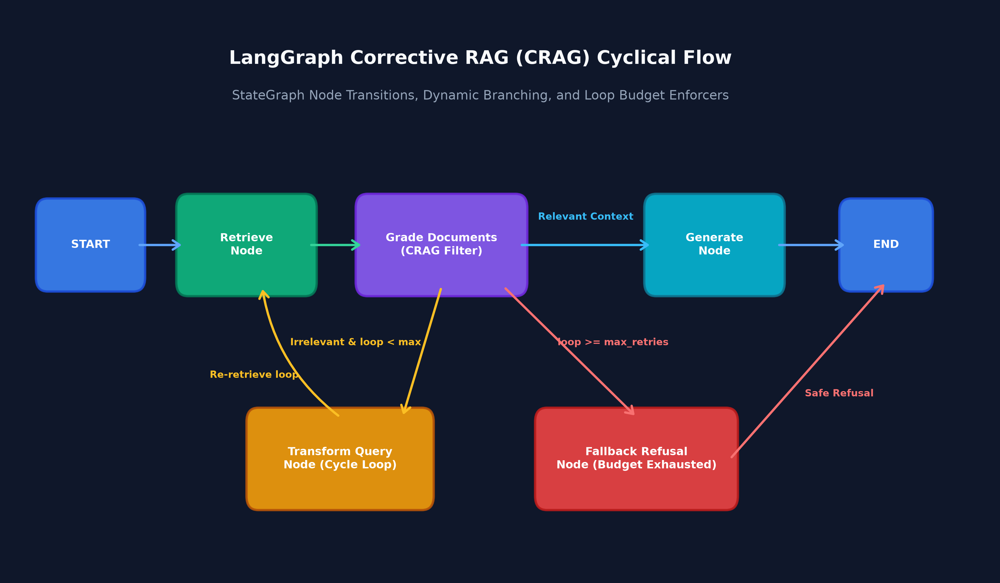
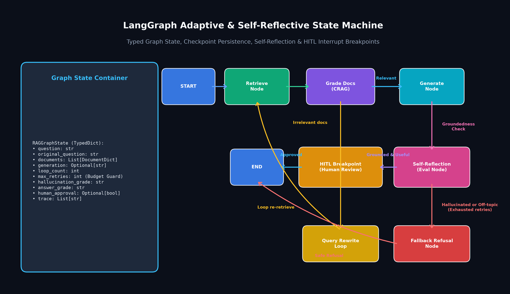

# Track 06 — LangGraph Stateful RAG: Cyclic State Machines, CRAG, Self-RAG & HITL

Welcome to Track 06 of the **RAG Engineering Academy**. This track transitions from unidirectional Directed Acyclic Graph (DAG) pipelines to stateful, cyclic multi-actor architectures using **LangGraph**.

---

## 1. Architectural Motivation: Why Unidirectional DAGs Fail

Traditional linear RAG pipelines (such as LCEL chains) assume data flows strictly forward:
$$\text{Query} \longrightarrow \text{Retriever} \longrightarrow \text{Context} \longrightarrow \text{LLM} \longrightarrow \text{Answer}$$

In production, linear pipelines suffer from three fatal failure modes:
1. **Unfiltered Context Poisoning**: When retrieval yields irrelevant or noisy documents, linear chains feed that noise directly to the LLM, leading to hallucinations.
2. **One-Shot Query Rigidity**: If a user's initial query is underspecified or noisy, a linear pipeline cannot reformulate the query and re-retrieve.
3. **Absence of Human Oversight**: High-stakes enterprise operations require human review before output delivery. Unidirectional chains cannot pause, await human input, and resume cleanly.

LangGraph solves these challenges by framing RAG as a **stateful cyclic computation graph** with checkpointing and dynamic conditional routing.

---

## 2. Core Architectural Patterns

### A. Corrective RAG (CRAG)
- **Document Relevance Grading**: Evaluates whether retrieved passages are semantically relevant to the question.
- **Cyclical Query Reformulation**: If documents fail relevance criteria, queries are rewritten and re-routed to retrieval.
- **Budget Enforcers**: Hard recursion limits (`max_retries`) prevent runaway looping and cost escalation.



### B. Self-Reflective RAG (Self-RAG)
- **Hallucination Evaluation (Groundedness)**: Checks whether every assertion in the synthesized response is explicitly grounded in the retrieved documents.
- **Answer Relevance Evaluation (Utility)**: Verifies that the answer directly addresses the user's inquiry rather than digressing.

### C. Enterprise Persistence & Human-in-the-Loop (HITL)
- **State Checkpointing**: `MemorySaver` preserves snapshot state per `thread_id`.
- **Dynamic Breakpoints**: `interrupt_before=["human_review"]` pauses execution before final synthesis or delivery.
- **State Modification & Time-Travel**: Human operators can inspect drafts, modify state variables (`human_approval=True`), and resume execution with `app.invoke(None, config)`.



---

## 3. Implemented Deliverables

| Deliverable | Path | Description |
|---|---|---|
| **Educational Notebook** | [`01_langgraph_stateful_rag.ipynb`](file:///Users/bharathm/Documents/Self%20Learning/RAG_from_scratch/tracks/06-langgraph-rag/01_langgraph_stateful_rag.ipynb) | 22-cell interactive, 100% offline-executable notebook adhering to the Markdown-before-code invariant. |
| **Common Graph Abstraction** | [`common/langgraph_rag.py`](file:///Users/bharathm/Documents/Self%20Learning/RAG_from_scratch/common/langgraph_rag.py) | Typed `RAGGraphState`, node factories, conditional routers, CRAG, Self-RAG, and Adaptive RAG state graphs. |
| **Unit Test Suite** | [`tests/unit/test_langgraph_rag.py`](file:///Users/bharathm/Documents/Self%20Learning/RAG_from_scratch/tests/unit/test_langgraph_rag.py) | 12 dedicated unit tests covering state creation, node routing, CRAG cycles, loop budgets, and HITL interrupts. |
| **Visual Architecture Diagrams** | [`assets/diagrams/track06_langgraph_crag_architecture.png`](file:///Users/bharathm/Documents/Self%20Learning/RAG_from_scratch/assets/diagrams/track06_langgraph_crag_architecture.png), [`assets/diagrams/track06_state_machine_cyclical_flow.png`](file:///Users/bharathm/Documents/Self%20Learning/RAG_from_scratch/assets/diagrams/track06_state_machine_cyclical_flow.png) | High-resolution architectural diagrams illustrating node transitions, loop budgets, and checkpoint state containers. |

---

## 4. Verification & Test Execution

Run the complete test suite within the `.venv312` virtual environment:

```bash
# Run Track 06 unit tests
.venv312/bin/pytest tests/unit/test_langgraph_rag.py -v

# Run the notebook validation suite
.venv312/bin/pytest tests/notebook_validation/test_notebook_structure.py -v

# Run the entire repository test suite (75 tests)
.venv312/bin/pytest tests/
```
