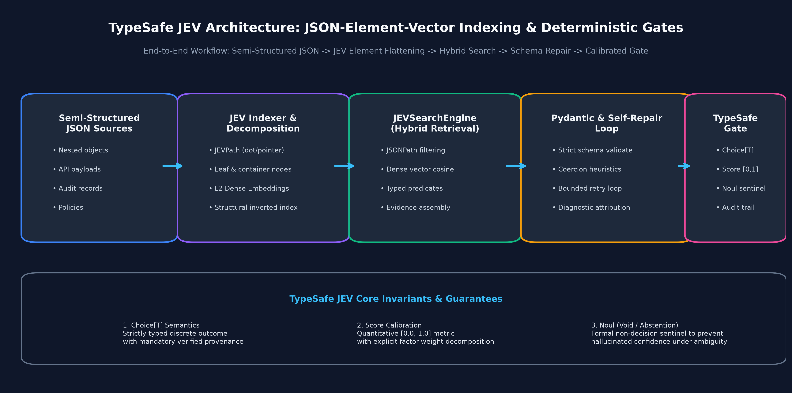
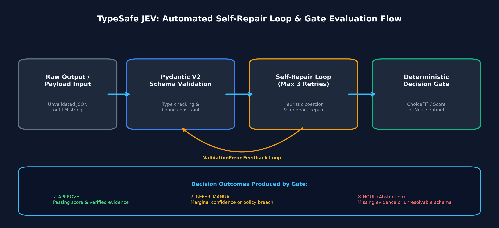

# Track 12 — TypeSafe JEV Decision Engine & JSON-Element-Vector Indexing

Deterministic typed decision gates, Choice, Score, and Noul semantics, Pydantic schema enforcement, and automated self-repair loops for mission-critical RAG applications.

---

## Overview

In enterprise transactional systems, unstructured LLM text generation is hazardous. Generative models can hallucinate schema keys, format numbers as non-standard strings, invent enum states, and project unwarranted confidence even when essential evidentiary documents are missing.

**Track 12** implements the **TypeSafe JEV** framework:
1. **JSON-Element-Vector (JEV) Indexing:** Flattens complex semi-structured documents into uniquely addressable `JEVElement` objects with dot-notation and RFC 6901 JSON pointer semantics, indexed alongside dense semantic embeddings.
2. **Hybrid Structural & Semantic Retrieval:** Combines cosine vector similarity with path-prefix constraints and typed functional predicates to eliminate semantic drift.
3. **Formal Mathematical Decision Primitives:**
   - `Choice[T]`: Strictly typed discrete decision outcome grounded in verified JSONPaths.
   - `Score`: Bounded $[0.0, 1.0]$ evaluation metric with normalized factor attribution weights.
   - `Noul`: Formal typed sentinel representing void, undecidable, or out-of-distribution states to eliminate false certainty.
4. **Automated Schema Self-Repair Loop (`SelfRepairLoop`):** Intercepts `ValidationError`s, applies deterministic heuristic type coercions (numeric strings, word numbers, list wrapping), and tracks repair histories.
5. **Deterministic Decision Gates (`DecisionGate`):** Enforces formal enterprise invariants (score thresholds, confidence margins, evidence path coverage, forbidden risk flags) with measured sub-millisecond execution latency.

---

## Notebooks

| Notebook | Focus | Key Topics | Status |
|---|---|---|---|
| [`01_typesafe_jev_decision_engine.ipynb`](file:///Users/bharathm/Documents/Self Learning/RAG_from_scratch/tracks/12-typesafe-jev/01_typesafe_jev_decision_engine.ipynb) | End-to-End JEV Decision Engine | JEV Decomposition, Choice/Score/Noul Primitives, DecisionGate, Pydantic V2 Extraction, Self-Repair Loops, Comparative Benchmarks | **COMPLETED** |

---

## Architecture

---

## Core Components (`common/typesafe_jev.py`)

- `JEVPath`: Dot-notation and RFC 6901 JSON pointer parser with wildcard pattern matching.
- `JEVElement`: Atomic or structural JSON element with type, value, vector embedding, and provenance.
- `JEVIndexer`: Recursive traverser and flattener with deterministic L2-normalized dense embeddings.
- `JEVSearchEngine`: In-memory hybrid vector and structural search engine.
- `Choice[T]`, `Score`, `Noul`, `is_noul`: Typed decision primitives.
- `DecisionGate`, `GateRule`, `GateResult`: Invariant verification and audit logging.
- `StructuredOutputExtractor`: Strips markdown fences and parses Pydantic V2 models.
- `SelfRepairLoop`: Automated heuristic repair of malformed schema payloads.
- `TypeSafeJEVUnderwritingEngine`: Complete end-to-end commercial underwriting pipeline.
- `compare_conditional_vs_jev`: Comparative evaluation demonstrating 0% crash rate in JEV vs high failure rates in naive `if/else` logic.
